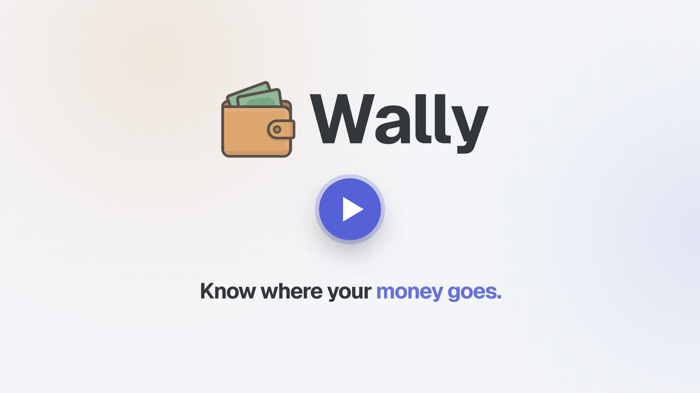

<div align="center">

<h1 align="center">Wally</h1>
</div>

<p align="center">
<a href="https://github.com/polius/Wally/actions/workflows/release.yml"></a>&nbsp;<a href="https://github.com/polius/Wally/releases"></a>&nbsp;<a href="https://hub.docker.com/r/poliuscorp/wally"></a>
</p>

<p align="center">
<b>Wally</b> is a lightweight, self-hosted money log for a household: what came in, where it went, and what's coming.
</p>

<p align="center">
  
  &nbsp;
  
</p>

## Features

- **Summary**: this month against last month, where the money went, what you kept each month and what's coming. Every number opens the transactions behind it.
- **Transactions**: search every month, filter and sort, a calendar, and bulk changes with Undo.
- **Recurring**: rent, subscriptions and salaries, added on their day. Price rises stand out.
- **A household**: each person's own spending, and shared costs split evenly, by income or by hand.
- **Month in review**: a recap of last month, ready on the 1st.
- **End-to-end encryption**, on by default with a password: whoever runs the server can't read your data.
- **On your phone**: installs on the home screen and opens full screen. Light and dark, 13 languages.

Wally never connects to a bank: you add what you spend.

## Quick Demo

Want to try Wally quickly? Run this command to start a demo instance with sample data:

```bash
docker run --rm -e DEMO=true -p 80:80 poliuscorp/wally
```

Then open [http://localhost](http://localhost) in your browser.

> **Note:** This runs in demo mode with pre-loaded data. Your changes won't persist after stopping the container. For a permanent installation, see below.

## Installation

Wally keeps its database in the folder you mount at `/wally/data`, so your data stays when the container restarts or is updated. Both examples use a `data` folder next to where you run them.

### Run with Docker CLI

```bash
docker run -d \
  --name wally \
  --restart unless-stopped \
  -p 80:80 \
  -v ./data:/wally/data \
  poliuscorp/wally
```

### Run with Docker Compose

```yaml
services:
  wally:
    image: poliuscorp/wally
    container_name: wally
    restart: unless-stopped
    ports:
      - "80:80"
    volumes:
      - ./data:/wally/data
```

Then open [http://localhost](http://localhost).

## Video

<p align="center">
  <a href="https://pol.alzina.dev/videos/wally.mp4">
    
  </a>
</p>
